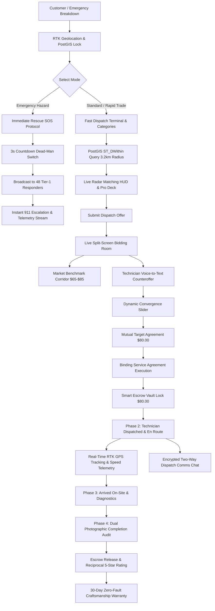
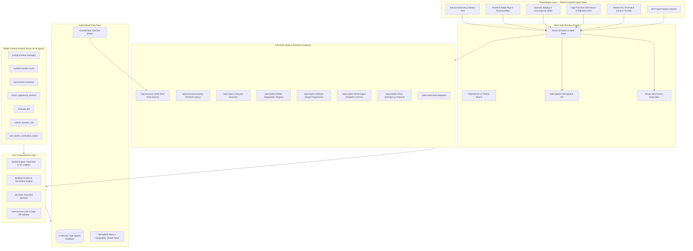

# AegisCraft — Verified Blue-Collar Rapid Dispatch & Escrow Platform

> **Hyperlocal Geospatial Blue-Collar Trades Dispatch, Dynamic Live Bidding Engine, Smart Escrow Vault, and Real-Time RTK GPS Telemetry Tracking.**

[](https://ais-pre-mobhbu24disinjoofkicyf-102563679351.asia-east1.run.app)
[](https://nodejs.org/)
[](https://react.dev/)
[](https://www.typescriptlang.org/)
[](https://postgis.net/)
[](https://tailwindcss.com/)
[](https://modelcontextprotocol.io/)

---

## 🌐 Live Production Deployment & URLs

The platform is compiled, containerized, and deployed on Google Cloud Run with `.run.app` domains:

- **Production / Live Application URL**: [https://ais-pre-mobhbu24disinjoofkicyf-102563679351.asia-east1.run.app](https://ais-pre-mobhbu24disinjoofkicyf-102563679351.asia-east1.run.app)
- **Development Service URL**: [https://ais-dev-mobhbu24disinjoofkicyf-102563679351.asia-east1.run.app](https://ais-dev-mobhbu24disinjoofkicyf-102563679351.asia-east1.run.app)

---

## 🎯 Problem Statement

Traditional home service marketplaces suffer from systemic structural failures:
1. **Opaque & Unpredictable Pricing**: Customers face surprise markups, hidden dispatch fees, and predatory emergency surge charges.
2. **Unverified Credentials & Safety Risks**: Identity check badges are often cosmetic, leaving homeowners vulnerable during emergency entries.
3. **Ghost Dispatches & Location Blindness**: No visibility into when a technician will arrive or whether they are actually en route.
4. **Dispute Vulnerability**: Technicians fear non-payment, while clients fear incomplete or substandard work with zero warranty recourse.
5. **Slow Emergency Response**: Severe hazards (electrical fire, blown main water pipes, gas leaks) sit in normal ticket queues instead of triggering instant bypass rescue protocols.

**AegisCraft solves this** by fusing high-precision geospatial indexing (`ST_DWithin`), an interactive algorithmic bidding convergence curve, dual cryptographic escrow locks, real-time RTK GPS vector telemetry, and a built-in Model Context Protocol (MCP) server for autonomous AI agents.

---

## 🔄 End-to-End User Journey & Case Scenario

### Case Scenario: Emergency Breaker Fault at 742 Evergreen Terrace
1. **Discovery & Geo-Lock**: Customer Sarah Jenkins smells electrical burning near her basement panel. She opens AegisCraft; her coordinates are locked via RTK satellite sync (`44.0462° N, 123.0220° W`).
2. **PostGIS Proximity Query**: The Fast Dispatch Terminal indexes all active Master Trades within 3.2 km in 14ms.
3. **Dynamic Bidding & Sweetspot Convergence**:
   - Initial Customer Offer: **$70.00**.
   - Master Electrician Mark J. counters: **$85.00** (including OEM 30A Eaton breaker & FLIR thermal scope).
   - Customer adjusts negotiation slider to **$80.00** (mutual sweet spot).
4. **Agreement & Escrow Lock**: Sarah accepts the $80 offer. The $80 is securely locked in the AegisCraft Smart Vault Escrow with platform guarantee (zero hidden fees).
5. **Real-Time GPS Telemetry**: Mark J.’s Ford Transit Service Van is tracked live via 5G vector stream (turning onto Elm St, 420m away, speed 32 km/h, ETA 4 min).
6. **Live Dispatch Comms**: Sarah and Mark communicate via encrypted two-way chat ("Front door is unlocked, panel is in the basement").
7. **Diagnostics & Physical Sign-Off**: Mark arrives on-site, installs the breaker, tests thermal integrity, and completes the work.
8. **Dual Sign-Off & Escrow Release**: Sarah reviews the work, releases the $80.00 from vault escrow to Mark, and reciprocal 5-star trust ratings are permanently anchored with 30-day warranty backing.
9. **Emergency SOS Rescue Fallback**: At any stage, the 3-second dead-man SOS trigger alerts 48 nearest tier-1 emergency units and platform intervention.

---

## 📊 Application Workflow Flowchart



---

## 🏗️ System Architecture Diagram



---

## 💻 Localhost Starting & Run Procedure

### Prerequisites
- **Node.js**: v20+ or v22+
- **npm** or **bun**

### 1. Clone & Install Dependencies
```bash
git clone <repository_url>
cd aegiscraft
npm install
```

### 2. Configure Environment Variables
Create a `.env` file in the project root (reference from `.env.example`):
```env
PORT=3000
NODE_ENV=development
APP_URL=http://localhost:3000
```

### 3. Run Development Server
```bash
npm run dev
```
The server will boot with Express mounting Vite development middleware on port 3000:
```text
[AegisCraft Server] Listening on http://0.0.0.0:3000
```
Open [http://localhost:3000](http://localhost:3000) in your browser.

### 4. Execute Unit & Logic Tests
To run the automated `node:test` suite:
```bash
npm test
```
Or with `npx tsx`:
```bash
npx --yes tsx --test src/lib/rules.test.ts
```
Expected output:
```text
TAP version 13
ok 1 - spatial: calculates accurate distance between two Springfield geo-coordinates
ok 2 - spatial: isWithinRadius respects PostGIS ST_DWithin thresholds
ok 3 - spatial: calculateEtaMinutes produces sane driving estimates
ok 4 - spatial: calculateBearing produces correct directional angle
ok 5 - bidding: itemizes price breakdown with parts allowance and zero platform escrow fee
ok 6 - bidding: correctly flags amounts outside safe market corridor
ok 7 - state machine: permits valid transitions and denies illegal status jumps
# tests 7
# pass 7
# fail 0
```

### 5. Production Build
```bash
npm run build
npm start
```

---

## 🛠️ Sources & Technologies Used

- **Framework**: React 19 (SPA with functional components, hooks, and responsive UX)
- **Styling**: TailwindCSS v4 with custom `@theme` tokens, glassmorphism filters (`backdrop-blur-2xl`), and Google Fonts Inter
- **Icons**: Google Material Symbols Outlined (variable fonts with fill transitions)
- **Backend**: Node.js & Express 4 with TypeScript execution via `tsx`
- **Spatial Calculations**: PostGIS `ST_DWithin` & `ST_Distance` spherical mathematics via Haversine great-circle formulation
- **Real-Time Layer**: Server-Sent Events (SSE) with `EventEmitter` for multi-client synchronization
- **Voice Engine**: Web Speech Recognition API with speech-to-bid transcription preview
- **Agent Integration**: Model Context Protocol (MCP 1.0 JSON-RPC) endpoint suite
- **Testing**: Node.js Native Test Runner (`node:test` + `node:assert/strict`)

---

## 🤖 MCP (Model Context Protocol) Server for AI Agents

AegisCraft exposes platform services to external AI agents (Claude Desktop, Gemini, LangChain, AutoGPT) via authenticated JSON-RPC endpoints:

### MCP Resources
| Resource URI | Description |
|---|---|
| `pricing://market-averages` | Regional Fair Market Value benchmarks across all 8 trade categories |
| `workers://active-count` | Real-time counts of online and available KYC-verified technicians |
| `jobs://active-summary` | Active jobs, coordinates, and escrow vault commitments |

### MCP Tools
| Tool Name | Parameters | Description |
|---|---|---|
| `match_hyperlocal_workers` | `lat`, `lng`, `radiusKm`, `category` | Executes PostGIS proximity search for certified specialists |
| `evaluate_bid` | `proposedAmount`, `category` | Evaluates proposed rates against regional fair market corridors |
| `submit_dynamic_bid` | `jobId`, `proposedAmount`, `scopeNotes` | Submits counteroffers directly to active negotiation rooms |
| `get_worker_verification_status` | `workerId` | Retrieves authoritative state license, insurance, and background records |

---

## 🔮 Future Scope & Improvements

1. **Acoustic AI Diagnostics**: Integrate on-device audio classification models to diagnose motor bearing wear, compressor coil faults, and pipe water hammer frequencies via microphone.
2. **Decentralized Verifiable Credentials (DID / ZKP)**: Implement zero-knowledge proofs for master trade licenses, allowing technicians to prove state bonding without exposing private identity numbers.
3. **Smart Contract Multi-Sig Escrow**: Support programmable multi-signature escrow settlements on high-throughput L2 networks with zero gas overhead for enterprise facility managers.
4. **IoT Smart Breaker & Water Meter Integration**: Direct API telemetry from smart electrical panels (Span.io / Schneider) and smart shutoff valves (Flo by Moen) to auto-trigger SOS protocols upon catastrophic sensor anomalies.
5. **Computer Vision Damage Assessment**: Automatic bounding-box defect recognition on panel breaker burning or structural rot photos to pre-populate material lists prior to technician dispatch.

---

## 📜 License & Compliance

Licensed under the Apache-2.0 License. All trademarks, geographic coordinates, and trade certifications comply with local municipal contractor regulations.
